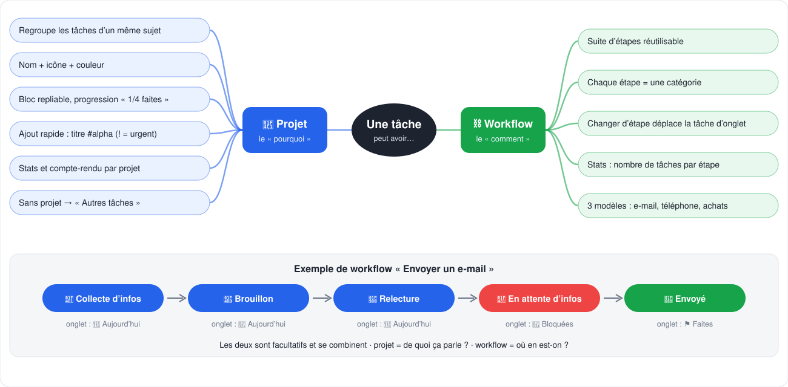
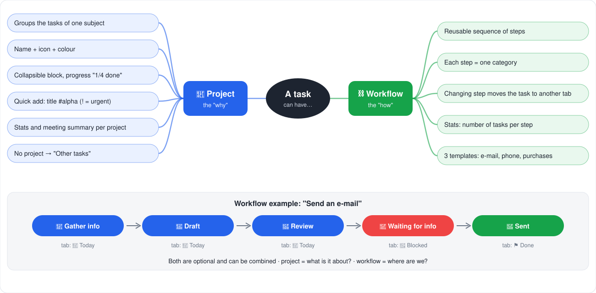

# I-travagli — Gestionnaire de tâches PWA

🇫🇷 [Français](#français) · 🇬🇧 [English](#english)

<p align="center">
  
  
  
</p>

---

## Français

Gestionnaire de tâches auto-hébergé : une seule page HTML, un petit serveur Python (stdlib uniquement) et un **mode hors ligne** (PWA). Les données sont stockées sur ton serveur ; si le serveur tombe, l'appli continue de fonctionner avec une copie locale puis se resynchronise toute seule.

### Fonctionnalités
- Listes (Réception, Aujourd'hui, Bloquées, Plus tard, Faites), projets, sous-tâches, échéances, urgences
- Réunions avec ordre du jour, décisions, envoi par e-mail / invitation `.ics`
- Import via API (`/api/import`, Raccourcis Apple, curl) et import Nyblit optionnel
- **Hors ligne** : copie locale (localStorage) + service worker ; fusion par tâche (`updatedAt`) et suppressions suivies (tombstones)
- Installable sur l'écran d'accueil (iPhone, Mac, Android)

### Projets et workflows : à quoi ça sert



Deux notions complémentaires, toutes deux facultatives. Une tâche peut avoir un projet, un workflow, les deux ou aucun.

**Projet = le « pourquoi » (regrouper).** Un projet rassemble les tâches d'un même sujet (« Projet Alpha », « Achats », « Travaux »…), avec un nom, une icône et une couleur.
- Chaque projet s'affiche en bloc repliable, avec sa progression (« 1/4 faites ») et son tri (urgence, échéance…).
- Les tâches sans projet vont dans « Autres tâches ».
- Ajout rapide : tape `Appeler le fournisseur #alpha` ; le projet est reconnu par son début de nom. Un `!` en tête marque la tâche urgente.
- Les statistiques et le compte-rendu se calculent par projet.

**Workflow = le « comment » (suivre un processus).** Un workflow est une suite d'étapes réutilisable, par exemple *Envoyer un e-mail* : collecte d'infos → brouillon → relecture → envoi.
- Chaque étape est rattachée à une catégorie : 🌱 Aujourd'hui, 🔴 Bloqué, 🟡 Plus tard ou ⚑ Terminé.
- Quand tu changes l'étape d'une tâche, elle **change automatiquement d'onglet** : « En attente d'infos » la place dans Bloquées, « Reporté » dans Plus tard, « Envoyé » dans Faites. Plus besoin de la déplacer à la main.
- Trois workflows sont fournis (e-mail, téléphone, achats) ; tu peux les modifier et en créer d'autres (⋮ → Workflow → *Gérer les workflows*).
- L'onglet Stats montre, par workflow, combien de tâches sont à chaque étape : on voit où ça coince (par exemple trop de commandes en attente de livraison).

En résumé : le **projet** répond à « de quoi ça parle ? », le **workflow** à « où en est-on dans le processus ? ».

### Installation
```bash
mkdir -p /opt/taches && cd /opt/taches
# copier index.html, taches_server.py, sw.js, manifest.webmanifest + votre icon.png (180x180)
TACHES_KEY="mon-code" python3 taches_server.py      # écoute sur le port 8088
```
Variables : `TACHES_PORT` (8088), `TACHES_HOST` (0.0.0.0), `TACHES_DATA` (data.json), `TACHES_KEY` (code d'accès de l'appli), `TACHES_TOKEN` (import), `NYBLIT_TOKEN` (import Nyblit).
Exemple de service systemd : lancer `python3 taches_server.py` dans `/opt/taches` avec `Restart=always`.

### ⚠️ HTTPS obligatoire pour le hors ligne
Un service worker ne fonctionne qu'en **HTTPS** (ou `localhost`). Place le serveur derrière un reverse proxy (Nginx Proxy Manager, Caddy, Traefik…) avec un certificat, et utilise l'adresse HTTPS, pas `http://IP:8088`. N'expose jamais le port 8088 directement.

### iPhone / Mac
1. Ouvrir l'adresse HTTPS, recharger 2-3 fois (le service worker s'installe puis prend la main).
2. iPhone : Partager → *Sur l'écran d'accueil*.
3. Test : couper le serveur, rouvrir → « 📴 hors ligne », ajouter une tâche, relancer le serveur, toucher le statut → « ☁ synchronisé ».

Ne pas effacer les données du site dans Safari avant synchronisation : les tâches non synchronisées y sont stockées.

### Diagnostic et mises à jour
- `https://votre-domaine/sw-status` : version, fichiers en cache, journal d'erreurs du service worker.
- Quand `index.html` change, incrémenter `const V = 'taches-vN'` dans `sw.js`.
- API : `GET/PUT /api/data` (`{rev, data}`, `409` si `rev` périmé), en-tête `X-Key` si `TACHES_KEY` est défini.

### Tests
```bash
node tests/test_sw.js          # service worker (mocks)
TACHES_PORT=18088 TACHES_DATA=/tmp/d.json python3 taches_server.py &
node tests/test_sync.js        # synchronisation contre le vrai serveur (port 18088)
```

---

## English

Self-hosted task manager: a single HTML page, a tiny Python server (standard library only) and an **offline mode** (PWA). Data lives on your server; if the server goes down, the app keeps working from a local copy and resyncs by itself.

### Features
- Lists (Inbox, Today, Blocked, Later, Done), projects, sub-tasks, due dates, urgent flag
- Meetings with agenda and decisions, sent by e-mail / `.ics` invite
- API import (`/api/import`, Apple Shortcuts, curl) and optional Nyblit import
- **Offline**: local copy (localStorage) + service worker; per-task merge (`updatedAt`) with tracked deletions (tombstones)
- Installable to the home screen (iPhone, Mac, Android)

### Projects and workflows: what they are for



Two complementary, optional concepts. A task can have a project, a workflow, both, or neither.

**Project = the "why" (grouping).** A project gathers the tasks of one subject ("Project Alpha", "Purchases", "Renovation"…), with a name, an icon and a colour.
- Each project is a collapsible block showing its progress ("1/4 done") and its own sorting (urgency, due date…).
- Tasks without a project go under "Other tasks".
- Quick add: type `Call the supplier #alpha`; the project is matched by the start of its name. A leading `!` flags the task as urgent.
- Stats and the meeting summary are computed per project.

**Workflow = the "how" (following a process).** A workflow is a reusable sequence of steps, for example *Send an e-mail*: gather info → draft → review → send.
- Each step belongs to a category: 🌱 Today, 🔴 Blocked, 🟡 Later or ⚑ Done.
- When you change a task's step it **moves to the matching tab by itself**: "Waiting for info" puts it in Blocked, "Postponed" in Later, "Sent" in Done. No manual dragging.
- Three workflows ship by default (e-mail, phone call, purchases); edit them or create your own (⋮ → Workflow → *Manage workflows*).
- The Stats tab shows how many tasks sit at each step of a workflow, so bottlenecks are visible (for instance too many orders waiting for delivery).

In short: the **project** answers "what is this about?", the **workflow** answers "where are we in the process?".

### Install
```bash
mkdir -p /opt/taches && cd /opt/taches
# copy index.html, taches_server.py, sw.js, manifest.webmanifest + your own icon.png (180x180)
TACHES_KEY="my-code" python3 taches_server.py      # listens on port 8088
```
Environment: `TACHES_PORT` (8088), `TACHES_HOST` (0.0.0.0), `TACHES_DATA` (data.json), `TACHES_KEY` (app access code), `TACHES_TOKEN` (import), `NYBLIT_TOKEN` (Nyblit import).
Systemd: run `python3 taches_server.py` from `/opt/taches` with `Restart=always`.

### ⚠️ HTTPS is required for offline mode
A service worker only runs over **HTTPS** (or `localhost`). Put the server behind a reverse proxy (Nginx Proxy Manager, Caddy, Traefik…) with a certificate and use the HTTPS URL, not `http://IP:8088`. Never expose port 8088 directly.

### iPhone / Mac
1. Open the HTTPS URL and reload 2-3 times (the service worker installs, then takes control).
2. iPhone: Share → *Add to Home Screen*.
3. Test: stop the server, reopen → "📴 offline", add a task, restart the server, tap the status → "☁ synced".

Do not clear site data in Safari before syncing: unsynced tasks are stored there.

### Diagnostics and updates
- `https://your-domain/sw-status`: version, cached files, service worker error log.
- When `index.html` changes, bump `const V = 'taches-vN'` in `sw.js`.
- API: `GET/PUT /api/data` (`{rev, data}`, `409` on stale `rev`), `X-Key` header when `TACHES_KEY` is set.

### Tests
```bash
node tests/test_sw.js          # service worker (mocks)
TACHES_PORT=18088 TACHES_DATA=/tmp/d.json python3 taches_server.py &
node tests/test_sync.js        # sync against the real server (port 18088)
```

## License
MIT
